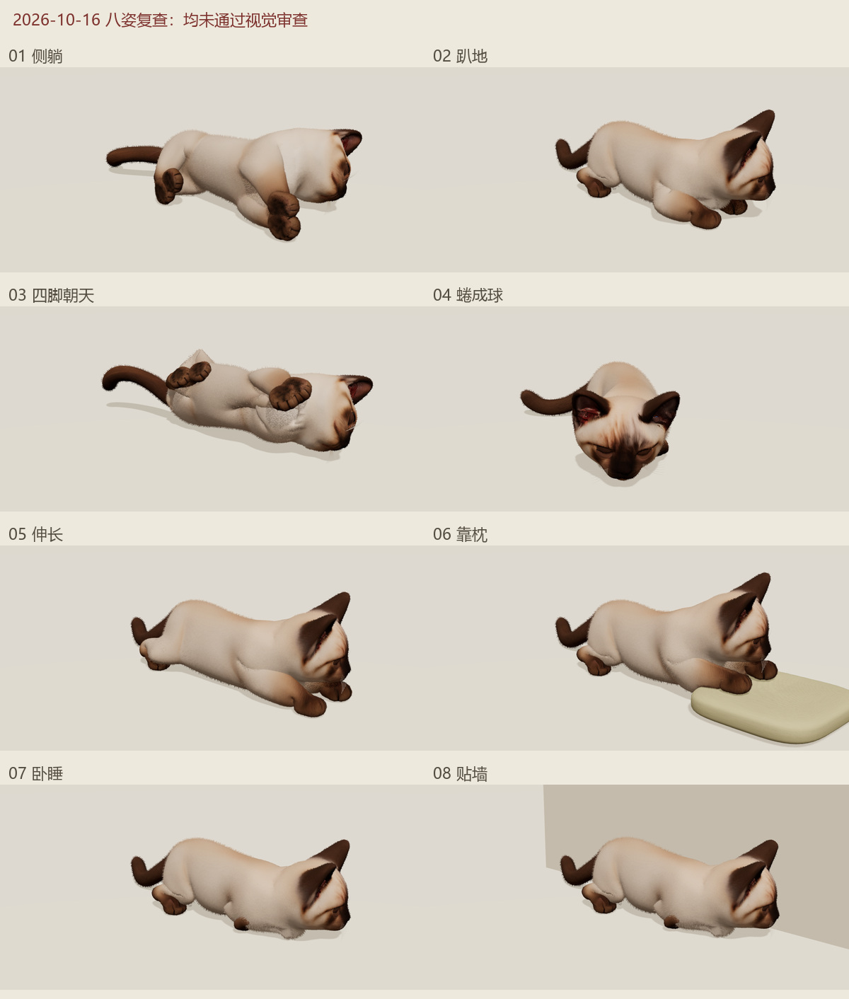
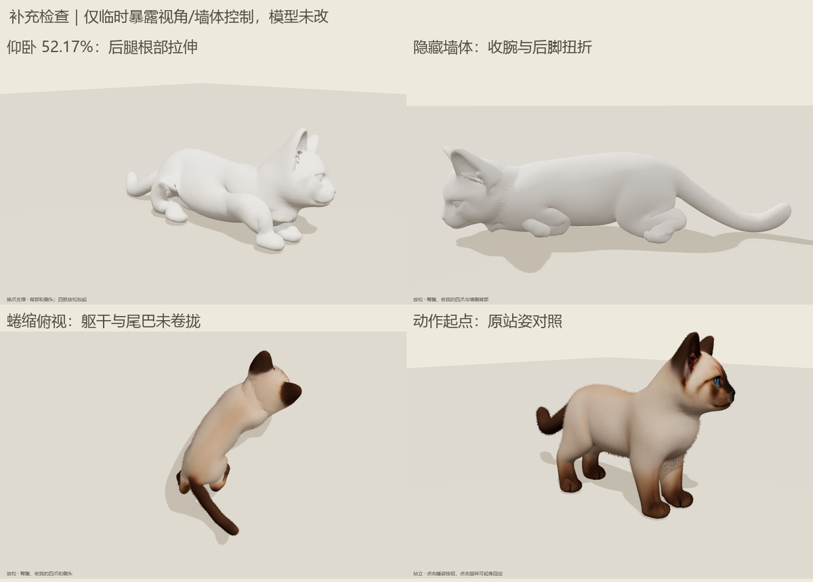

# 猫咪八姿复查（2026-10-16）

**结论：八姿均未通过视觉审查。本轮完成诊断，未修改模型、动作或正式页。**

检查当前 35 骨候选：真实 Chrome、1200×900、88 张原始截图，覆盖八姿各 5 个动作进度、5 个终态视角和 2 个素模视角；分别播放躺下、点击起身。原始记录保留在本机 `tmp/cat-posture-audit-20261016/`，本目录保存对照图与测量摘要。

| 姿势 | 复现的问题 | 证据 |
| --- | --- | --- |
| 01 侧躺 | P1：肩部形成硬楔，前腿内侧出现薄片，肘腕与脚掌过渡生硬；四爪堆叠。 | [多视角/素模](side-views.jpg) · [过渡](side-timeline.jpg) |
| 02 趴地 | P1：前肘鼓包、后脚折成钩状；头胸仍像蹲伏，没有参考图贴地展开的轮廓。 | [多视角/素模](prone-views.jpg) · [过渡](prone-timeline.jpg) |
| 03 四脚朝天 | P1：前后爪分别挤成一对，后腿根部出现尖片，颈肩有拉长薄膜；与用户截图一致。 | [多视角/素模](belly-views.jpg) · [过渡](belly-timeline.jpg) |
| 04 蜷成球 | P1/P2：后脚扭折；主要变化是头颈转向，躯干仍长、尾巴外伸，没有形成团状轮廓。 | [多视角/素模](curl-views.jpg) · [过渡](curl-timeline.jpg) |
| 05 伸长 | P1/P2：肩臂呈粗块，后脚仍折在髋下；只拉开爪的位置，未呈现参考图的侧身舒展。 | [多视角/素模](stretch-views.jpg) · [过渡](stretch-timeline.jpg) |
| 06 靠枕 | P1/P2：前臂肿大、后脚扭折；爪搭在枕边，头颈仍是抬起的蹲姿。 | [多视角/素模](pillow-views.jpg) · [过渡](pillow-timeline.jpg) |
| 07 卧睡 | P1：收腕后出现片状挤压，脚掌从胸下侧向突出；后脚呈钩状，整体仍有明显蹲伏感。 | [多视角/素模](loaf-views.jpg) · [过渡](loaf-timeline.jpg) |
| 08 贴墙 | P1/P2：继承卧睡的四肢缺陷，主要是整体平移到墙边；原侧面视角被墙遮挡。 | [多视角/素模](wall-views.jpg) · [过渡](wall-timeline.jpg) |

P1 表示明显网格/关节变形；P2 表示姿态轮廓或审看能力不足。

另用临时诊断入口补拍 6 张截图，隐藏墙体检查被遮挡的一侧，并核对仰卧最大拉伸帧、蜷缩俯视及站姿起点。只增加诊断控制，未改变模型或姿态数据。

## 定位依据

- 隐藏毛发和贴图后问题仍在，不能用材质解释。仰卧的身体滚转与头部朝向分别硬编码，四爪又套用共同身体旋转与局部目标，未得到自然的逐关节收放（`scripts/cat-supported-rest.js`）。
- 体积求解器约束骨骼锚点及地面/枕面，缺少肢体之间、肢体与躯干之间的自碰撞约束；局部保形不能替代正确的关节目标（`scripts/art/cat_volume_skin.py`）。
- 重新运行现有 1112 帧检查仍为 `passed`。但仰卧进度 **52.17%** 的一条身体网格边从 **0.01165 拉长至 0.06530（5.61 倍）**。旧脚本只用接地、帧位移和 99 分位拉伸判失败，没有把局部极值、尖片、自穿插及姿势轮廓纳入验收（`scripts/verify-cat-eight-poses.mjs:20`）。
- 消除整体平移后，卧睡与贴墙的身体顶点均方根差仅 **0.000245 模型单位**，证实两者终态形状基本复用。此值用于比较几何，不能解释为现实尺寸。

## 修复顺序与复测条件

1. 先重做侧躺、仰卧的肩胛—肘—腕、髋—膝—跗关节目标与权重，消除硬楔、尖片和脚掌扭折；保留原猫咪脸型与毛色。
2. 分别建立八姿终态：逐一核对身体轮廓、四肢归属、脚掌方向和真实支撑，再制作躺下与起身。蜷缩需卷起躯干与尾巴；伸长需展开肢体；贴墙需有独立靠墙姿态。
3. 每姿复测正/侧/背/俯视、去毛素模及完整过渡；增加关节局部拉伸、自碰撞和支撑区域检查。技术检查与视觉结论分别记录，当前结果不能标为姿态修复完成。

## 验证记录

- `npm run build`、`npm run check` 通过；现有 16 段片段/1112 帧网格检查通过，**视觉检查未通过**。
- 浏览器每姿各采样 94 帧躺下、94 帧起身，共 1504 条状态。主检查无脚本/资源错误，有 1 条旧阴影类型兼容警告；这些状态记录只证明播放路径，视觉判断依据上述截图。
- 公网 GLB 与本地逐字节一致，SHA-256：`a56a2a44f374ee111afc3a080747d3e972f5ab0f91edf297fb8bf6134e8c8fca`；公网查看器也逐字节一致，运行清单内容一致。
- [浏览器摘要](browser-summary.json)、[补查记录](details.json)、[身体局部测量](geometry-diagnosis.json)、[重跑的技术检查](technical-geometry.json)。本轮审查八种睡姿并对照站姿起点，正式页行走及手机实机不在本次范围。
