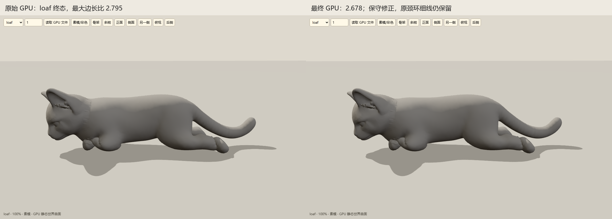

# 颈部修正与回退门禁（review）

冻结脚本 `scripts/art/cat_anatomy_v2_fairing.py`，SHA-256：`79d82badf65e00bd8605188de47c68df94bb66d749b796d3ffbfa0dd2b71b6fd`。原源仍为 `4cfc520e91637d5f130eeb886d79f1ecc5c061d3e3c4edb885cf2615341ef846`；顶点、UV、贴图和站姿不变。

颈带合并躯干链质量，再按 `y+1.4z=.84→1.01` 连续过渡至头骨；耳质量在 `0→.005` 连续退出。只对动作后曲面跟随 DQ 目标，不启用 Taubin、周期拟合或腕部试验。

```text
--neck-mode dq-continuous --neck-dq-blend .8 --cycles 0 --gpu <设备> --memory-limit 4294967296
```

另传 `--input`、`--skin`、`--output`、`--poses`。父 GPU 来源须有 `*-manifest.json`；输出记录输入、父产物、脚本、GPU UUID 与参数哈希链。

安全约束：

- 支撑面复用原 CUDA solver：地面 `.003`、运动枕头双线性高度场；只投影本轮实际改动的非保护颈点。
- 对原长 >2mm 的全部 43823 条边，统一缩小整帧位移 alpha，确保最终 f32 边长不超过 `max(raw边长,1.95×原边长)+1e-7`。
- 门禁后修改点仍低于支撑面超过 `1e-6` 时，整帧逐字恢复 raw 与原法线；不声称 raw 原有接地问题已修复。

最终两台 L20 CuPy 的 `solved/final-v1` 八姿共 168 帧已只读复核：0 条边越界，站姿整帧逐字保持，保护脸耳/域外位移与全部共享点间距均为 0，域外法线逐字保持。side 最后 4 帧因约束冲突整帧回退；belly/curl 终态 alpha 仅 `2.19e-6/5.52e-6`，基本拒绝颈部修正。未沿用旧无遮挡试验的显著改善叙述。

loaf 终态大边最大比值 `2.795→2.678`，wall 为 `2.586→2.402`；其余部分只弱修正或回退。此项说明没有放大原坏边，不证明无自交或视觉完全通过。



原 `d=.84` 裁切环细线、颈/腕局部褶皱仍存在，需要局部重拓扑。射线拾取定位到 body 面 17193、15654、17434、17665、17841 等原环面。当前为待审看候选，不代表八姿全面视觉通过或人工批准。

最终 GPU 原始核验记录：`docs/cat-repair-v2-review/binding-final-guard.json`；脚本：`scripts/art/cat_anatomy_v2_guard_verify.py`。主任务的整体改善来自新绑定、姿态与 CUDA 体积/接触修正，本补充只负责局部修正的保守门禁。
