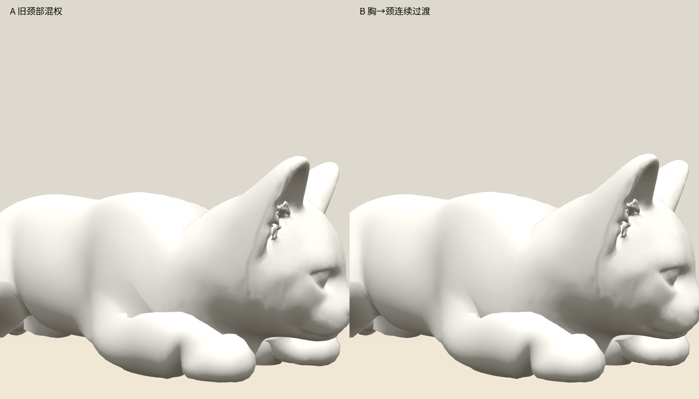
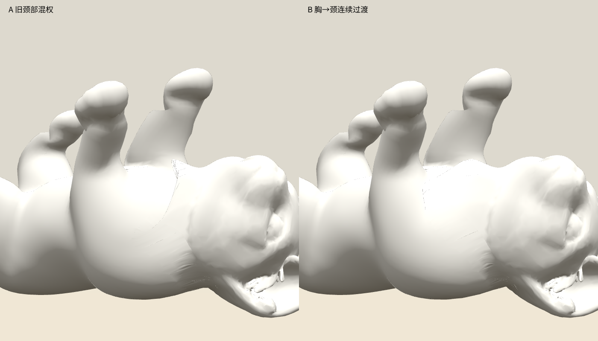

# 后颈拓扑与颈部混权

状态：`review`。最终中立候选位于 `tmp/cat-repair-v2/neck-weighted/anatomy-neutral.glb`，SHA-256：`4cfc520e91637d5f130eeb886d79f1ecc5c061d3e3c4edb885cf2615341ef846`。待 GPU 厚度约束、八姿连续播放及视觉复核。

## 两个独立原因

- 旧 GPU 硬约束把 `y+1.4z>.92` 当作头骨。头部边 `[22,26]` 两端实际只有 `43.6%/63.1%` 头骨权重，却被锁在胸/头混合目标上，造成约 `4.4` 倍拉伸；这条边本身完整、无孔洞，不应补面。
- 原后颈切面 `y+1.4z≈.84` 另有 `16` 条开边、`4` 个分裂三角扇、`15` 片近共线面。头身外接缝的共享点对应并不能证明内部拓扑完好。

## 修复

- 局部折叠 15 条近共线边，移除 30 片旧面，新增 12 片补面。复用空出的身体顶点槽 `10049` 作补面中点，没有增加顶点，总数仍为 `18857`。
- 仅该空槽的 POSITION、NORMAL、UV 和皮肤权重更新；原头部 POSITION、NORMAL、UV、索引及全部图片逐字节不变。使用新候选须重新生成 GPU goals。
- 颈带把胸骨质量平滑转给颈骨，保留原头骨与耳骨质量。例如点 22：`胸.504/颈.060/头.436 → 胸0/颈.564/头.436`；避免下巴基部直接跨头胸混权。
- 校验结果：开边、非流形边、分裂三角扇、绕向不一致、面积小于 `1e-10` 的三角均为 `0`。

## 实测边界

真实 Chrome 完成四姿、四视角共 16 张 A/B 截图，零脚本或资源异常。已审看低机位与侧面：新版减少下巴后的尖垂片和颈口凹孔，脸部轮廓保留。raw 蒙皮仍有折面，不能视为最终通过。

| raw 颈带，41 帧 | 旧混权最大边拉伸 | 新混权 |
| --- | ---: | ---: |
| 趴地 | 4.40 | 3.53 |
| 靠枕 | 4.00 | 2.96 |
| 仰卧 | 4.78 | 4.00 |
| 蜷缩 | 4.05 | 4.38 |

蜷缩局部极值仍上升，必须继续检查。原距颈轴大于 `.04`、动作后挤入 `.025` 的点，在趴地/靠枕/仰卧从 `52/40/57` 降为 `0`；这个量仅用于定位塌陷，不是解剖合格阈值。





[拓扑记录](binding-neck-topology.json) · [混权记录](binding-neck-weights.json) · [保留项检查](binding-neck-preservation.json) · [raw 对照](binding-neck-raw-probe.json) · [浏览器记录](binding-neck-browser.json)

```powershell
node scripts/art/cat_anatomy_v2_neck.mjs
node scripts/art/cat_anatomy_v2_neck_weights.mjs
node scripts/art/cat_anatomy_v2_neck_probe.mjs
```
