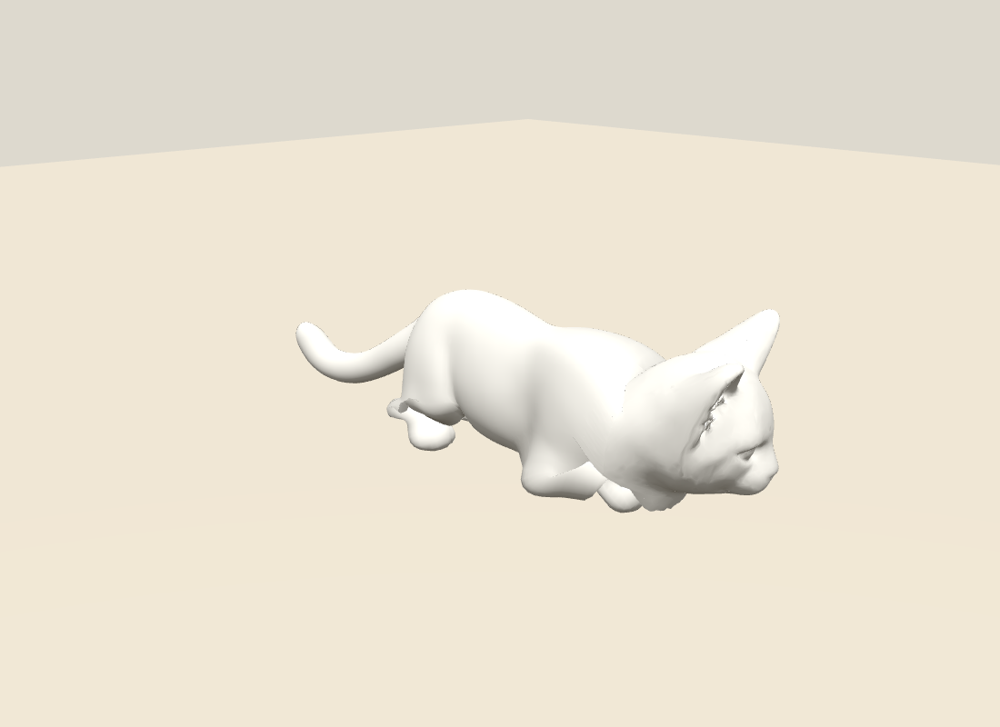
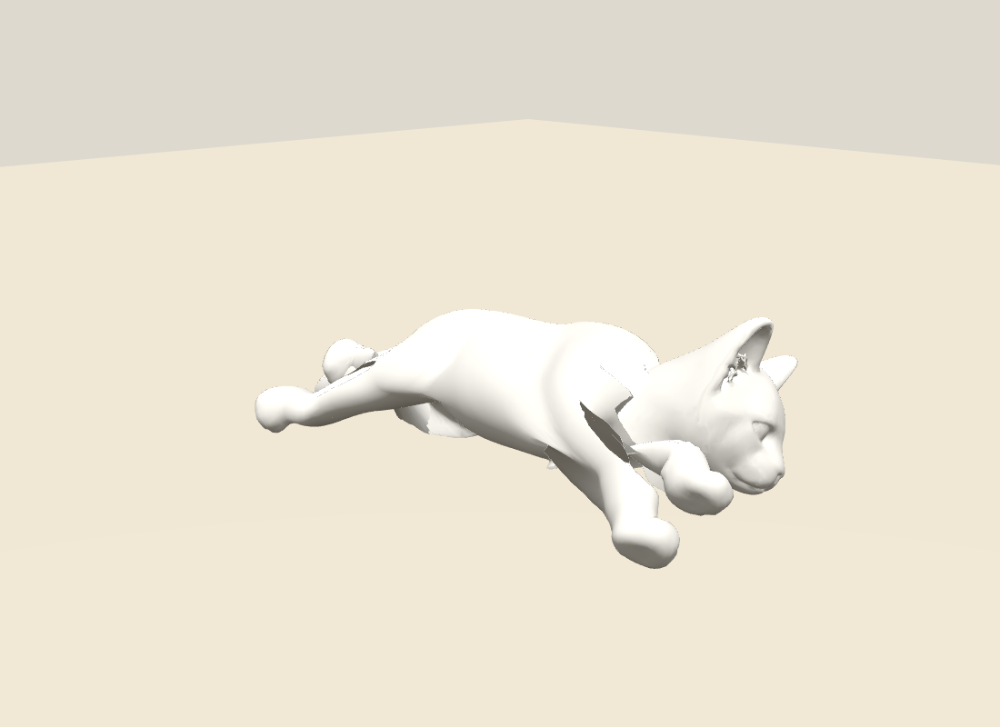

# 猫咪关节绑定修复

状态：`review`，未获视觉批准。保留原 GPU 猫咪曲面、脸型、UV 和毛色，不重新生成整猫。

## 已修正

- 原 `clean-bound.glb` 只有 33 骨；接入 35 骨后，新后跗骨原来没有皮肤权重。现按真实三角面截线拟合左右跗中心，并分配独立连续权重。
- 肘膝、腕跗改用相邻骨段夹角平分面的宽过渡；脚掌在静止高度 0.035～0.095 间平滑过渡，避免刚性边界形成薄片。
- 补充肩髋外侧渐变附着；原头、颈缝、脚底保持，共享顶点统一权重。
- 仅两根跗骨的位置改变；其余骨位置保留。35 根骨的 inverseBind 全部重算。

## 验证

- 原 POSITION、NORMAL、UV、三角索引及全部图片逐字节一致；中立曲面最大数值误差 `2.86e-8`，共享缝权重误差 `2.22e-16`。
- 10 类单关节、每类 25 帧原始线性蒙皮压力测试，最大边拉伸均持平或下降；左/右跗关节由 `3.54/3.53` 降至 `1.72/2.14`。这些是压力测试，不是自然姿态合格证明。
- 原身体单连通、无非流形边；15 个近退化三角均位于旧颈部拼接平面，未修改拓扑。
- 八姿旧/新各 51 帧 raw 对照：侧躺最大边拉伸 `9.66→4.58`，仰卧 `10.72→3.74`；两姿最近脚掌中心距离分别由 `0.056/0.033` 增至 `0.130/0.131`。旧/新动作也同时变化，不能单独归因于权重。
- 已审看真实 Chrome 截图：趴地前臂更连贯，卧睡收腕破片减少；伸长仍有肩腋内翻和髋后薄片。骨长保持不能替代皮肤视觉验收。





## GPU 交接

候选：`tmp/cat-repair-v2/anatomy-neutral.glb`。生成命令：

```powershell
node scripts/art/build_cat_eight_poses.mjs --neutral-only
node scripts/art/cat_anatomy_v2_bind.mjs
node scripts/art/cat_anatomy_v2_probe.mjs
node scripts/art/cat_anatomy_v2_poses.mjs
```

- `anatomy-skeleton.json`：35 骨静止位置与父索引。
- `binding.json`：`chains[].segments` 提供骨段起止点、长度和胶囊半径；`chains[].bases` 提供正交基与四元数；`jointBisectorAxes` 提供关节权重过渡轴。
- [绑定实测](binding-measurements.json)；[单关节压力测试](binding-joint-stress.json)；[八姿原始蒙皮对照](binding-pose-comparison.json)。`worstEdge` 包含最坏边的动作进度、原长、端点坐标和皮肤权重。
- 体积求解重点：肩腋与躯干连接、髋后皮肤、腕跗及脚掌过渡。地面五姿 raw 仍有 `4.43～8.98` 倍局部边拉伸，必须检查所有边极值和连续多视角，不能仅检查 p99。

以上候选未接入正式页；GPU 补形、完整连续视觉复核和用户审看仍待完成。
