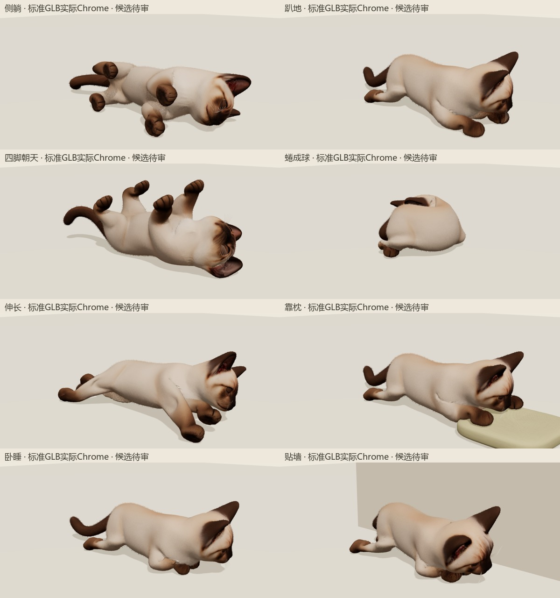

# 标准 GLB 本地复核

- 资产 SHA256：`61fc99bcf77c6bba94bcfdc503586117880029aa6ce211ac22cc136d95ad7863`；93,763,000 字节（89.42 MiB），35 骨、18,857 顶点、300 补形、16 动作。
- 真实压缩 GLB 由 Three AnimationMixer 按 60fps 与导出关键帧重放，最大世界曲面误差 `0.001797871`，原站姿误差 `3.095e-8`。仅补形有界量化；原几何、UV、蒙皮和纹理无损。
- 实际 Chrome 完成八姿进入、暂停、五视角、25%/50%/75% 进度、点击猫咪起身、慢速及隐藏墙体；72 张截图，脚本/资源错误为 0。原始证据在本机 `tmp/cat-ground-v2-final-review/`。
- 本机首次可操作耗时 7.508 秒；独立加载内存采样为 V8 已用 503,042,248 字节、缓冲区后备存储 612,071,008 字节，流式补形纹理 23,953,408 字节。这是加载就绪时采样，不能作为峰值或进程总内存。
- 原长大于 `0.002` 的边，实际 GLB 最大拉伸为四脚朝天 `3.33810`、卧睡 `2.98593`，与最终 GPU 曲面极值一致；详见 `ground-glb-edges.json`。

直接审看彩色与素模：后足方向、四肢分离、卧睡/贴墙后展和下巴伏枕保留，未见导出新增尖片；4500 根桌面毛卡与 6 层毛壳仍有连续细毛感。颈圈细锯线和部分腕根细褶仍可见，外观继续待审，技术验证不代表人工批准。

