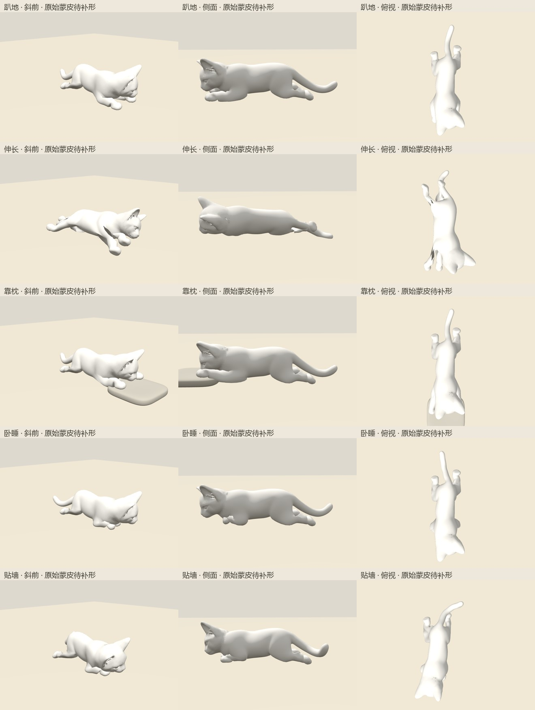
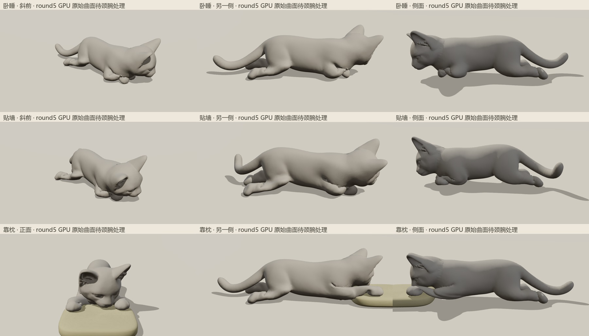

# 地面五姿重做

控制模块：`scripts/cat-ground-poses-v2.js`。保留原脸型、毛色和站姿；每次调用前由外层恢复中立骨架。

| 姿势 | 独立轮廓与关节目标 |
| --- | --- |
| 趴地 | 胸腹降低，前爪分开前伸；后爪后移，跗点位于爪的前上方，趾端沿尾侧展开。 |
| 伸长 | 身体轻侧卧，四肢分别向头侧/尾侧展开，后足趾端指向尾侧。 |
| 靠枕 | 先搭爪再降低头颈；前爪分开给下巴留出枕面，后肢短幅后展。 |
| 卧睡 | 前腕位于肩前，逐只收拢；前脚掌仅旋转 0.68 弧度，后肢短幅后展。 |
| 贴墙 | 骨盆侧倾、脊柱逐节侧弯、四肢不对称收拢；完成后才贴近墙面。 |

双段 IK 保持原骨长；前肘中心不低于 0.055，后膝不低于 0.060 模型单位。脚掌独立定向，后腿额外控制跗段。

接口：`createGroundCatPoses(context)` 返回 `(id, t) => state`；`context` 与原 rig 一致，额外 `solve`、`shiftWorld` 不使用。

## 当前验证

- 新中立骨架上逐姿采样 101 帧，共 505 帧：原站姿误差 0，骨长最大误差小于 2e-16；见 `ground-skeleton.json`。
- 最终 `4cfc520e...` 中立模型上真实 Chrome 每姿斜前、两侧、正面、俯视，共 25 张素模；原始记录在本机 `tmp/cat-ground-v2-anatomy-shots/`。
- 权重连续化后卧睡/贴墙腕部破片减少、趴地前臂更连续；伸长肩腋内翻片仍明显。还需 GPU 体积补形、完整过渡、带毛/素模多视角复核。
- 根据 GPU round3 再修后足：五姿均采用跗点位于爪前上方、趾端朝尾侧；卧睡、靠枕、贴墙只缩短后展幅度，避免内收方案形成环。三姿跗内角已从约 49–76 度展开至 145–173 度，最新原始蒙皮侧面不再形成后足环；皮肤仍待新 GPU 结果复核。
- round4 实际曲面仍有卧睡/贴墙髋后深夹缝；DQS 对照仅略改善截面，未解决夹缝。因此进一步后展后腿、减轻髋跗压缩；当前两姿跗内角约 154–165 度，原始蒙皮未再成环。
- 靠枕前爪分至左右 `±0.155`；用口鼻前下方 504 个纯头顶点测得下巴距枕面 `0.006`。颈弧降至 `0.58–0.62`，头部保留自然低俯，避免强反向抵消。
- round5 已用冻结模块 `030a19eb75b1ec72ed1de175119ef0b13076327df3baeb02883d25048a49def2` 完成 21 关键帧 GPU 求解。终态 30 张实际浏览器复查：卧睡/贴墙髋后深夹缝和跗端尖折明显消失，靠枕下巴落于两爪间枕面。仍有颈圈锯线、靠枕腕根薄沟和卧睡前腕靠颈夹缝，待独立处理。

最终标准 GLB 已通过真实压缩重导入和本地 Chrome 交互复核，见 `ground-glb-review.md`。**颈圈与腕根细褶仍待审，尚不能判定全部外观修复完成。**
