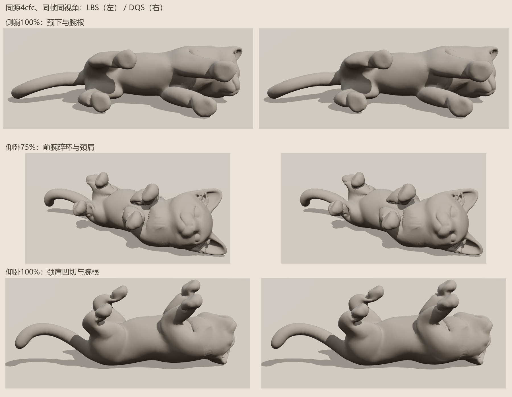

# DQS 对照

**DQS 对侧躺略有帮助，未解决颈/腕问题；仰卧局部边极值变坏，不能据此通过视觉验收。**

同一 `input-round4` 源与骨架，真实 Chrome 同帧同视角素模/彩色检查，零浏览器异常。完整三角 QC：两姿各五帧，共十帧。

| 进度 | LBS 大边极值 → DQS | LBS 新宏观交叉对 → DQS |
| --- | --- | --- |
| 侧躺 75% | 2.059 → 1.868 | 170 → 141 |
| 侧躺 100% | 2.668 → 2.568 | 153 → 137 |
| 仰卧 50% | 2.013 → 2.497 | 1157 → 1108 |
| 仰卧 75% | 2.555 → 2.996 | 755 → 707 |
| 仰卧 100% | 3.139 → 3.307 | 151 → 139 |

宏观候选阈值仍为交线 `≥0.002` 且平面深度代理 `≥0.001`；不是现实尺寸或穿透体积。侧躺终态宏观最大深度代理 `0.01056 → 0.01077`，没有改善。

仰卧 75% 的前腕碎环、颈肩凹切仍可见；侧躺终态腕根台阶也保留。下一步应针对颈部与腕根保形，不能只切换蒙皮算法。

[DQS 几何报告](surface-qc-round4-dq.json) · [LBS 几何报告](surface-qc-round4.json)
