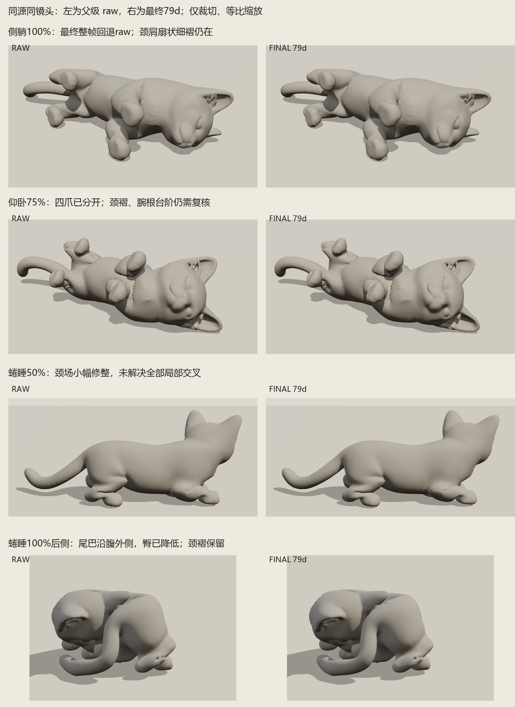

# 三种卧姿最终几何复核

状态：`review`，人工美术验收待定。保护区域与溯源核验通过；颈肩细褶、腕根台阶和局部曲面交叉仍在，不能标记为全部视觉通过。

本报告只对应 `solved/final-v1`，侧躺、仰卧、蜷睡各 21 帧，共 63 帧，完整几何检查耗时 59.5 秒。输入为 `input-round6-final`；源 SHA256 `4cfc520e91637d5f130eeb886d79f1ecc5c061d3e3c4edb885cf2615341ef846`，goals `335d9e6342ab5cc46d6468307e8a91e03eb6adc8e29ea3cb144537543c0b1528`，后处理 `79d82badf65e00bd8605188de47c68df94bb66d749b796d3ffbfa0dd2b71b6fd`。姿态模块仍为冻结的 `fa03e877…`。旧颈场试验已拒绝，移至临时目录，不用于本结论。

与实际父级 raw 文件逐字核对：6463 个受保护脸耳顶点、14575 个颈域外顶点、1862 个腕/爪/跗权重顶点的位置及法线完全一致；三姿起始帧整帧一致。侧躺 85%、90%、95%、100% 修整因接地与边长约束冲突而拒绝，四帧位置及法线均完整回退 raw。源文件、UV、贴图未替换。所有原长大于 0.002 的 47358 条索引边均满足最终边长守卫，最大约束余量为负值，无越界。

| 姿势 | 终态最大原边倍率 | 全程峰值 | 终态超过 2 倍的边 | 终态新增显著交叉面片对 | 交叉线最大长度 / 平面深度代理 |
| --- | ---: | ---: | ---: | ---: | ---: |
| 侧躺 | 2.5684 | 2.5684，100% | 25，0.0528% | 117 | 0.008505 / 0.008228 |
| 仰卧 | 3.1392 | 3.3381，95% | 110，0.2323% | 149 | 0.009605 / 0.008858 |
| 蜷睡 | 3.2645 | 3.3160，95% | 164，0.3463% | 870 | 0.010732 / 0.012114 |

交叉使用真正非相邻三角形测试，排除源同位置焊接邻接，并扣除源及起始帧已有面片对。“显著”为交线至少 0.002、平面深度代理至少 0.001；数值为模型坐标单位，代理不是实体穿透距离，面片对数不等于独立缺陷数。过渡同样有残留：最大交线为仰卧 55% 的 0.016922，最大深度代理为仰卧 60% 的 0.013148，主要涉及颈肩与四肢折叠处。

源网格自身已有 44 对交叉，未混称为动作新增。旧补面近共面交叉在起始帧就会出现交线长度敏感变化，因此同时保留源与起始帧基线；仰卧旧面片对 15550/17919 的深度代理由源 0.002075 到末帧 0.002391，仍需审看。252 对头身同位置焊缝全程间隙为 0，无新增退化面，坐标与法线均有限。局部面面积收缩至原值 10% 以下仍存在，单帧最多侧躺 6、仰卧 16、蜷睡 19 面；每帧 18 个零法线顶点与 raw 的集合完全相同。

实际浏览器已看素模与原贴图终态五视角、蜷睡追加后侧，以及 50%、75%、90% 关键帧；未报页面或资源错误。侧躺和仰卧四爪位置较初始问题分开，但颈肩扇状细褶、腕根台阶仍清楚可见。蜷睡尾巴沿腹外侧低位绕行，21 帧未检出头颈与尾巴交叉；后侧图确认尾不跨脸、臀面较上一版降低，仍保留颈褶和肘髋内折。

本轮实际收益有限：蜷睡 50% 新锐折由 raw 的 56 处减至 48 处，局部可见轻微变顺；终态侧躺已回退，仰卧/蜷睡最大位置改动仅约 1.55e-7 / 3.77e-7，肉眼近似 raw。边长守卫拦下了旧颈场带来的大拉伸，也几乎拦掉终态修整，不能将这一结果描述为颈腕问题已修复。

完整证据：[63 帧几何数据](surface-qc-final-v1-roll.json)、[保护域与拒绝帧字节核验](surface-qc-final-v1-protection.json)、[精简数值表](surface-qc-final-v1-summary.json)。本次未改姿态、源网格或算法。
