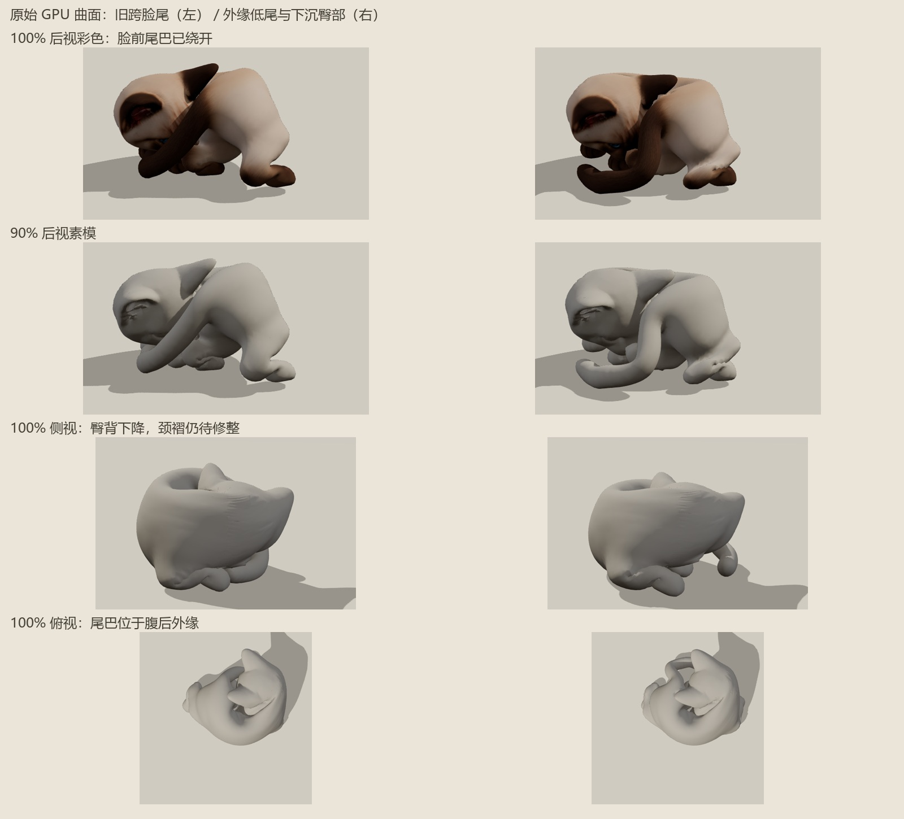

# 外缘尾第四版 GPU 复查

**跨脸尾巴已修正，臀背下降；肩颈、腕髋曲面仍需修整，尚未整体通过视觉验收。**

最终源、goals、新 GPU manifest 均匹配。21 帧完整三角 QC 约 19 秒，头颈—尾巴真交叉与宏观候选全程均为零，旧版终态为 15 对宏观候选。0.75/0.9/1 前后视及终态多视角、素模/彩色共 22 张真实 Chrome 截图零异常。

| 进度 | 大边极值 | 新宏观交叉对 | 最大宏观交线 / 深度代理 |
| --- | ---: | ---: | --- |
| 75% | 2.435 | 525 | 0.01169 / 0.01171 |
| 90% | 3.312 | 802 | 0.01054 / 0.01253 |
| 100% | 3.264 | 870 | 0.01073 / 0.01211 |

全程边峰 `3.316 @95%`，2315–10444；源原有 44 对未出现宏观加深报警。尺度为模型坐标，平面深度不是穿透体积，两个最大值可能来自不同面数对。

实际后视确认尾巴绕开脸前；1065 个原臀部表面的最低高度 `0.06562 → 0.02610`，中位高度 `0.18861 → 0.14456`，与轮廓下沉一致。外背弧连续，75% 仍是抬头过渡，90%/100% 收头。仍有肩颈扇形褶与下侧肘/髋夹皱，不能仅因尾巴不穿脸就认定全部曲面合格。

[完整 QC](surface-qc-round6-raw-curl.json) · [原臀部表面高度对照](surface-qc-round6-curl-rump.json)。冻结模块仍为 `fa03e877...`，后续只进行曲面修整。
