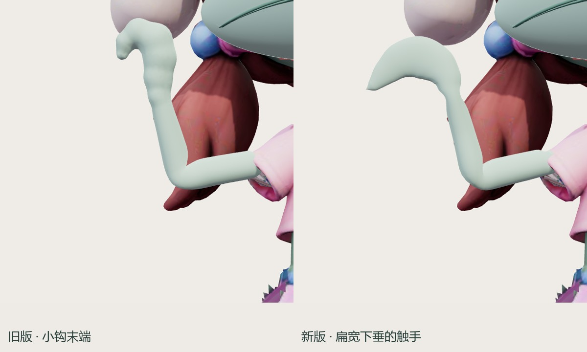
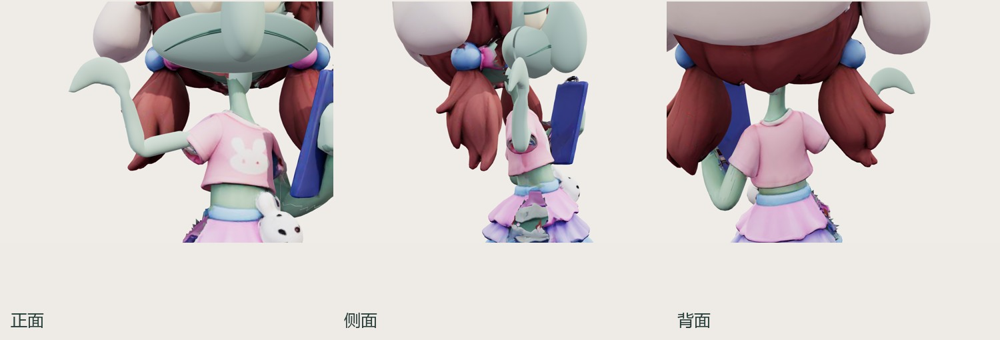
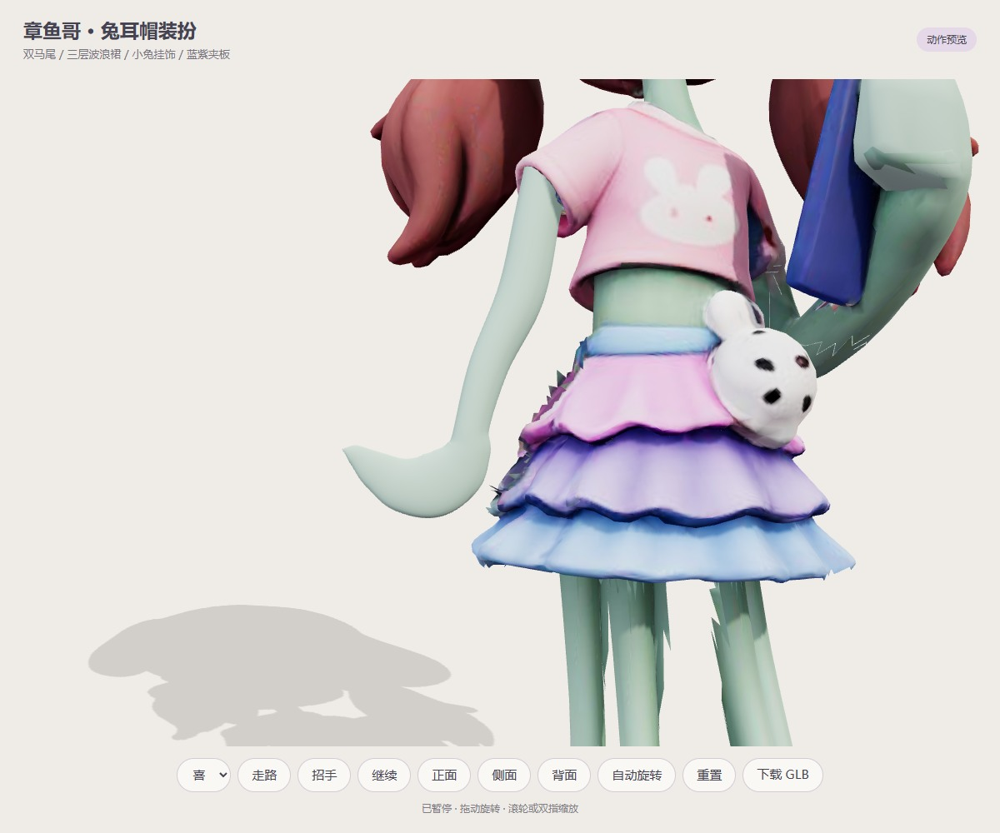

# 章鱼哥触手 v22

状态：待用户审看。v21 小钩末端已被用户否定，上一轮技术检查不代表造型获批。

[动作近景](../../squidward-model.html?v=20261016-hand-22b) · [家中活动](../squidward-home/?v=20261016-hand-22b)

- 左臂改为连续椭圆截面放样；末端扁宽、向外展开并自然下垂，无分叉、指头和小钩。沿路径重新平滑分配肩肘腕权重；垂手向外留出裙摆间距，分摊抬手旋转，清理原扫描左手残留 131 个三角形。
- 删除「看夹板」按钮、自动活动及 GLB 的 `read` 片段，动作仅留休息、走路与招手。原手持夹板作为装扮保留。
- 喜怒哀、四脚、服饰与其他原有网格沿用 v21；原服饰局部扫描接缝仍存在。

## 来源与验证

沿用自有 `gsy013` Hunyuan3D-2.1 任务 `413330331cd042a58d2cdb1080863637`，本轮为局部重拓扑，无新 GPU 任务。导出 55,789 三角形、24 骨、3 段动作；SHA256 见模型旁 `asset.json`。

```powershell
node scripts/art/optimize-squidward-reference.mjs
node scripts/verify-squidward-wave-asset.mjs
npm run build
npm run check
node scripts/verify-squidward-reference-browser.mjs
```

- `animation-check.json`：97 帧连续变形、封闭网格、权重归一化、起止闭合和四脚单连通通过；新增手端宽度、扁平程度及下垂量检查，防止回退成小钩。
- 左臂拉伸与面积极值单独记录；至少 99% 三角形面积比例超过 0.12，不宣称全部局部变形无损。
- `browser-local.json`：真实 Chrome 原生切换喜怒哀、120 帧招手/120 帧步态、三视角、多阶段、角色点击/连续点击、桌面/390×844 手机视口通过，零脚本与资源异常；验证两个入口及自主活动均无看夹板动作。
- 手机实机性能与用户视觉审看尚未完成。






