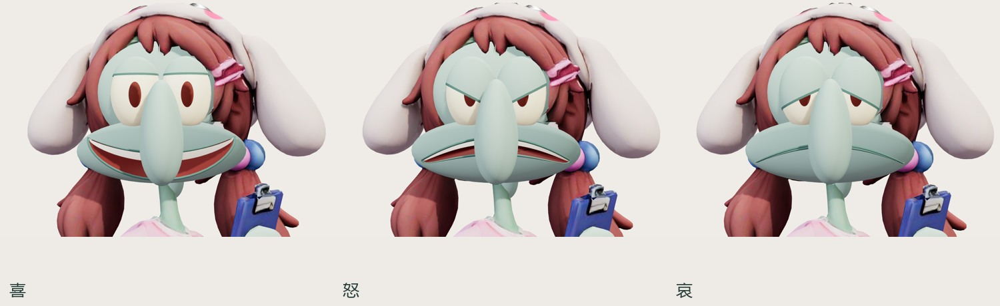
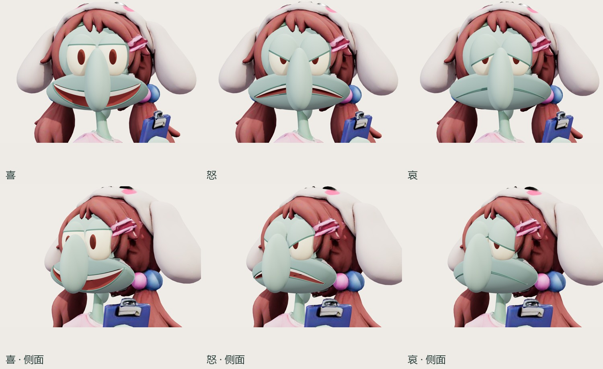
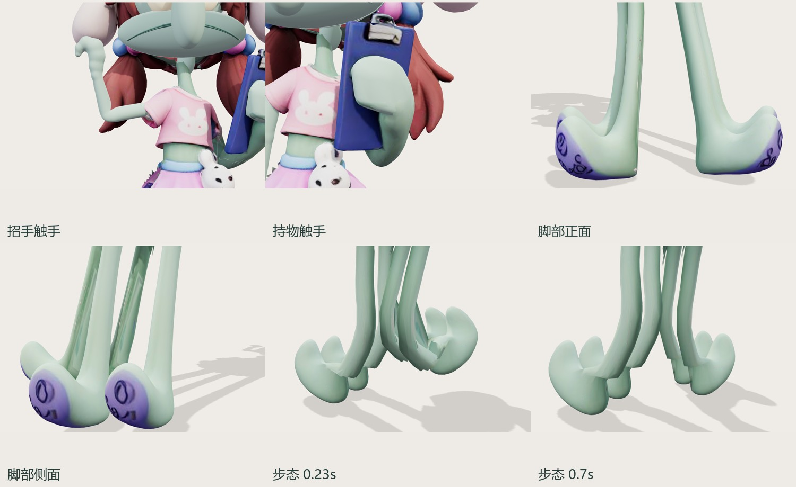
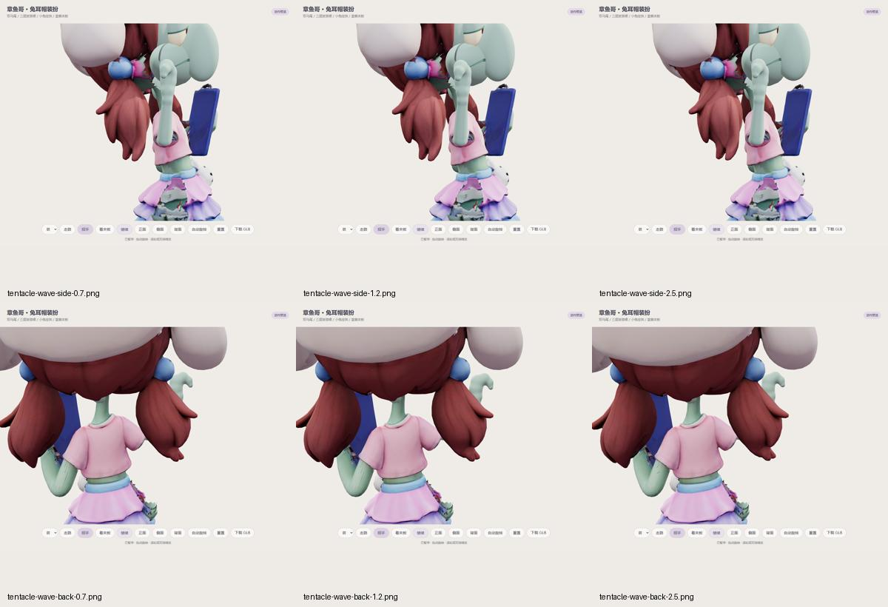

# 章鱼哥参考修正 v21

状态：待用户审看；技术检查通过不代表视觉批准。

[模型近景](../../squidward-model.html?v=20261015-reference-21) · [家中活动](../squidward-home/?v=20261015-reference-21)

- 双手为完整触手，无独立手指；保留卷曲末端和原夹板连接。
- 四脚删除 6 块脱落条片、1,416 个三角形，保留原弯脚与紫色吸盘。
- 表情仅有喜、怒、哀：分别采用睁眼露齿、眼睑内侧下压配下垂嘴角、眼睑内侧抬高配闭口下垂。头脸、眼球、眼睑、口腔和牙齿为可旋转的三维曲面；动作切换保留表情。

## 来源与复现

沿用自有 `gsy013` Hunyuan3D-2.1 任务 `413330331cd042a58d2cdb1080863637` 的服饰、贴图与骨架。本轮为局部网格修形和表情曲面制作，没有新 GPU 生成任务。原始绑定来源与哈希见模型旁的 `asset.json`；身体选区以原索引哈希防止误用。

```powershell
node scripts/art/optimize-squidward-reference.mjs
node scripts/verify-squidward-wave-asset.mjs
npm run build
npm run check
node scripts/verify-squidward-reference-browser.mjs
```

导出：58,724 个三角形，24 骨，4 个动作片段；形变仅保留三表情与眨眼。最终 SHA256 见 `../../assets/models/squidward-bunny/asset.json`。

## 验证

- `animation-check.json`：97 帧招手、封闭左臂、归一化权重、起止闭合及四脚单连通。最大边长拉伸 1.536 倍；至少 99% 三角形面积保留超过 12%，微小三角形面积极值另记为 0.00867，不宣称全部局部变形无损。
- `browser-local.json`：原生选择喜怒哀并测量实际顶点差异；120 帧招手与 120 帧走路、动作切换、角色点击/连续点击、家中活动、桌面及 390×844 手机视口，零脚本与资源异常。
- `browser-live.json`：同组公网交互通过；`public-resources.json`：功能提交 `afe706d` 的 7 个关键资源逐字节一致，Pages 发布成功。
- 逐张审看表情正面/侧面、招手各阶段、脚部正侧背与步态、持物触手及手机截图。浏览器视口检查不等于手机实机性能验收。
- 原服饰的局部扫描接缝仍存在；造型与动作观感等待用户审看。








