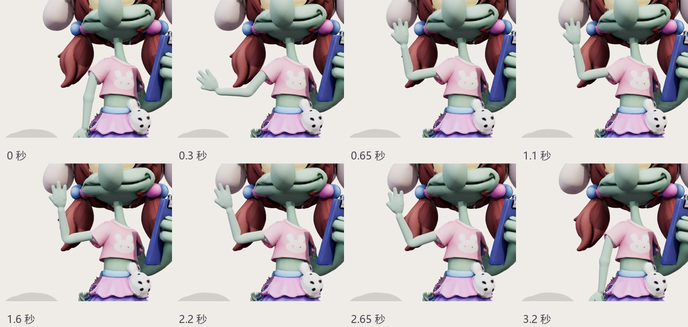
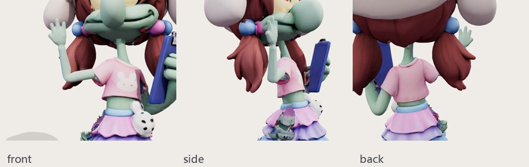

# 章鱼哥招手修正

- 旧动作把手折向胸口，肩肘腕与网格不对齐，手掌存在开口。
- 只重做左臂封闭网格、关节与权重；改为垂手起止、抬到脸旁轻摆。连续点击不会重置动作。
- 原自有 GPU v18 为基础，本轮使用本地网格修整；左臂沿用原贴图肤色采样，其他网格、贴图和表情保留。原模型裙摆局部破面仍存在。
- 重建：`node scripts/art/repair-squidward-wave.mjs`。默认从固定历史提交读取原件，不重复重绑新版本。
- 验证：构建、资源检查；97 帧封闭性、权重、连续性、伸长与面积分布；浏览器 120 帧、三视角各八时刻、角色点击、重复点击、动作切换和手机视口触控。
- 网格极值与原始采样见 `asset-check.json`；浏览器结果见 `browser-local.json`、`browser-live.json`。细小三角形面积极值单独记录，不能等同所有局部形变都已获视觉批准。
- 用户观感待确认；手机实机性能未测。
- `4b60105` 已通过 Pages，7 个公网关键资源与提交逐字节一致；线上浏览器完整复测通过，零脚本异常与资源失败。

